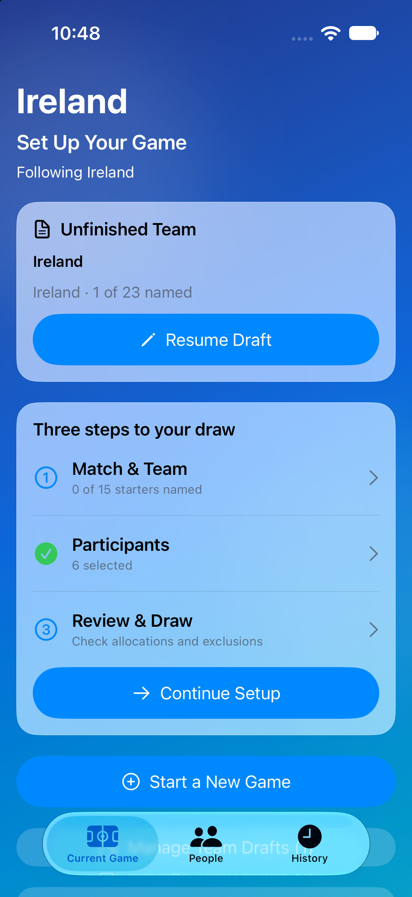
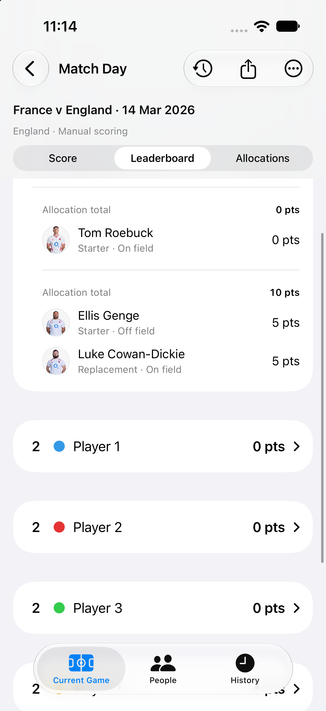
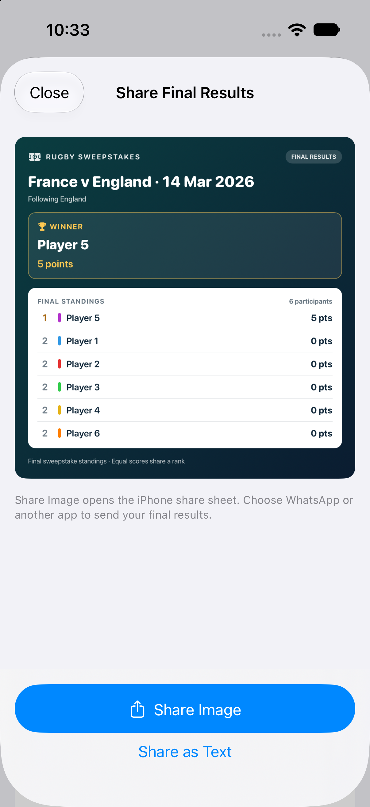

# Ruck of the Draw


A private SwiftUI iPhone app for running a rugby sweepstake with friends. Choose a match and one team, randomly allocate its starting players, record points during the game, and share the draw and final results as images.

Previously named **Rugby Sweepstakes Game**. The Xcode project, repository and bundle identifier retain their original names to preserve app identity and saved data.

## How a game works

1. **Match & Team** — choose a live fixture or set up manually, then finalise the 15 starters and eight replacements. Import an available lineup, read a team-sheet photo, or type names yourself.
2. **Participants** — select saved people or add new participants.
3. **Review & Draw** — check the team and exclusions, then run the random draw. Every participant receives the same number of starting players.
4. **Match Day** — record scores and substitutions, follow the leaderboard, and refresh the separate live match scoreboard.
5. **Finish & Share** — complete the game, save the results and share an image through WhatsApp or another app.

A participant keeps the points scored by their allocated starter **and any replacements in that allocation**. For example, a starter scoring five points followed by a replacement scoring five gives that participant ten points. The leaderboard shows each player's contribution.

Read the illustrated [User Guide](docs/USER_GUIDE.md) for the full walkthrough.

## Screenshots

Screenshots use sample participants. The sharing previews below were captured before the rename and show the former heading; version 1.1 uses **Ruck of the Draw**.

| Setup and drafts | Replacement scoring | Share final results |
| --- | --- | --- |
|  |  |  |

## Main features

- Guided setup, reusable participants and equal random allocations.
- Unfinished team drafts with resume, delete and discard options.
- Tries, conversions, penalties and drop goals, with scoring history and corrections.
- Substitution chains that retain the starter's place in the on-field list.
- Live fixtures, available lineups and a manually refreshed match scoreboard through Highlightly.
- Player portraits from saved catalogues and supported online sources, with initials when unavailable.
- Draw and results images for the iPhone share sheet, plus text sharing.
- Saved game history, completed-game protection and reopening for corrections.
- JSON backup and restore, including a recovery copy before replacement.

## Live data and photos

Use **Connect Highlightly** in the fixture import screen to enter your own Highlightly Rugby API key. It is stored in the device Keychain, excluded from backups and never required to build or run automated tests. Enter it separately on each device.

Competition, fixture and lineup availability depend on the provider, your plan and publication timing. This includes Premiership and international fixtures where covered. A listed match may not yet have a lineup; manual entry and team-sheet photo import remain available. The live scoreboard does not automatically award sweepstake points: scoring and substitutions are entered by the organiser.

Player photos can come from the saved England/Ireland catalogues, additional supported squad pages and TheSportsDB fallback. Photo availability varies, and imported names and shirt numbers should always be checked. Team-sheet photo import reads names; it does not extract player portraits.

## Build and run

- macOS with Xcode supporting the project's iOS 26.1 deployment target and Icon Composer assets.
- An iOS 26.1+ iPhone or compatible simulator.
- No third-party package installation is required.

Open `Rugby Sweepstakes Game.xcodeproj`, select the **Ruck of the Draw** scheme and choose an iPhone simulator. For a physical device, select your own development team under Signing & Capabilities. The existing bundle ID is `com.MarkHoldsworth.Rugby-Sweepstakes-Game`.

Current TestFlight release: **1.1 (3)**, uploaded and installed on a physical iPhone on 3 November 2026.

## Regression tests

```sh
./Scripts/test-regressions.sh
```

Or select **Ruck of the Draw Regression** in Xcode and use **Product → Test**. The script uses a dedicated simulator and writes logs and an `.xcresult` bundle to the ignored `.test-results/` folder.

The latest validation passed **41 tests**, with zero failures, on two consecutive runs. Coverage includes draws, scoring, replacement chains, history, drafts, backups, mocked network responses, photo matching and share-image rendering. See [test documentation](RuckOfTheDrawTests/README.md) for setup, destination overrides and physical-device checks.

## Project layout

| Location | Purpose |
| --- | --- |
| `Rugby Sweepstakes Game/Models` | Games, allocations, scoring and saved results |
| `Rugby Sweepstakes Game/ViewModels` | Game operations and live scoreboard state |
| `Rugby Sweepstakes Game/Views` | Setup, match day, sharing, history and backup screens |
| `Rugby Sweepstakes Game/Services` | Persistence, imports, credentials, photo catalogues and backup |
| `RuckOfTheDrawTests` | Automated regression suite |
| `Scripts` | Command-line test runner |

Games are stored on the device. Export a backup before moving to another device or deleting the app. Backups contain game and participant data, but exclude private API keys and downloaded portrait files; photo URLs are retained for later downloads.
