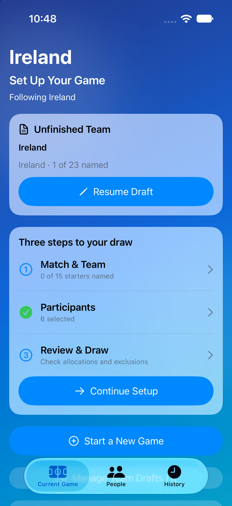
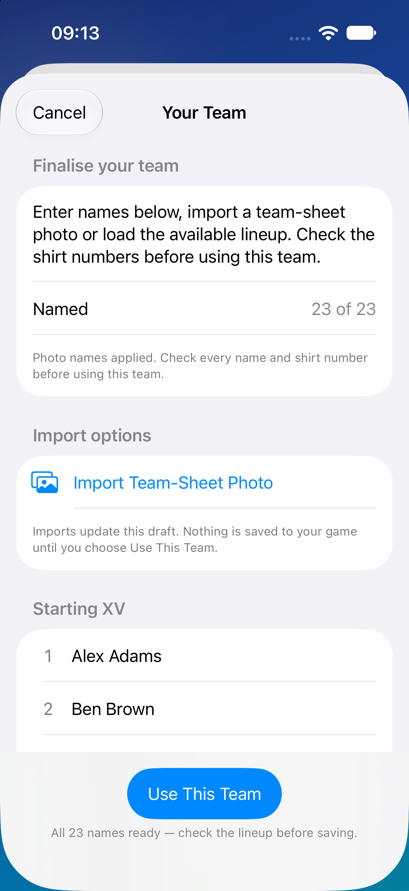
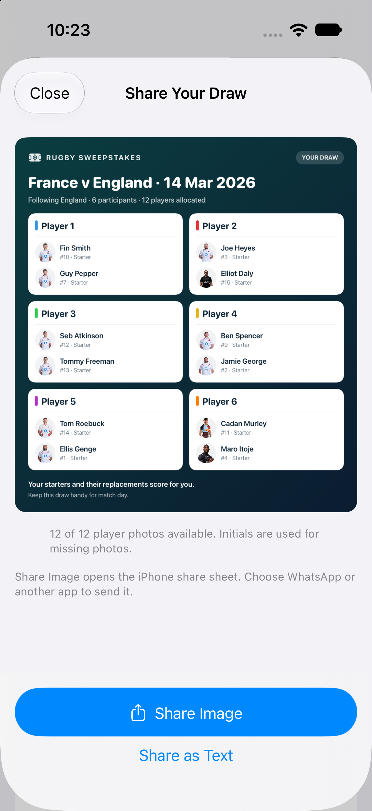
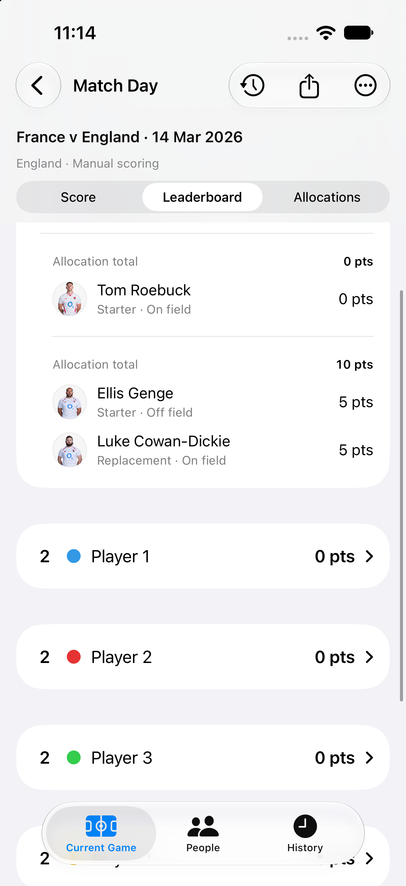
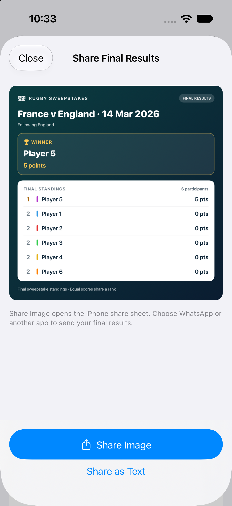
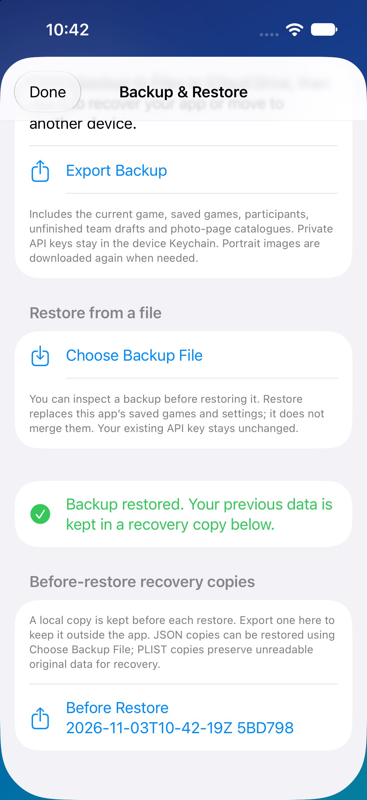

# Using Ruck of the Draw

[Back to README](../README.md)

## 1. Start a game

The **Current Game** tab is your home screen. Choose **Start a New Game** to archive the current game and begin another. Setup has three steps: **Match & Team**, **Participants**, and **Review & Draw**.

The match title uses the two teams and date when fixture details are available. You follow one side's players for the sweepstake.

## 2. Find the match and finalise the team

For live fixtures, choose a date and competition, load fixtures, select the match and choose the side to follow. Use **Connect Highlightly** if no API key has been saved on this device. The key button lets you manage that connection later.

The finalisation screen brings the import options together:

- **Load Lineup** imports a lineup when the provider has published one.
- **Import Team-Sheet Photo** reads names from an image for review.
- Manual fields let you complete or correct the team yourself.
- Photo-source options help match player portraits from supported squad pages.

Check all names and shirt numbers, including the eight bench players. Choose **Use This Team** when all 23 names are ready. Imports update the draft first; they only become the game team when you confirm it.

If the match exists but no lineup is available, wait for publication or use manual/photo entry. Finding a fixture does not guarantee a published lineup.

## 3. Save an unfinished team

Use **Save Draft & Close** to leave team finalisation and return later. **Resume Draft** appears on the home screen for an unfinished team in the current game. **Manage Team Drafts** lets you review and delete saved drafts. **Discard Draft** removes the unfinished draft rather than applying it to the game.

Drafts are associated with their game, fixture and team so work on one team does not overwrite another.

## 4. Select participants and run the draw

Use **Participants** to choose the people taking part. Saved people are reusable from the **People** tab.

You need at least two participants, and the number of enabled starters must divide equally between them. In **Review & Draw**, exclude starters if necessary. For example, six participants can each receive two of 12 enabled starters, leaving three excluded from the draw. Check exclusions before drawing.

Run the draw once ready. Team and participant selection are then locked for that draw. Open **View & Share Allocations** to review who received each player.

## 5. Share the draw

Open the draw's share preview and choose **Share Image**. In the iPhone share sheet, select WhatsApp or another destination. **Share as Text** is also available. Missing portraits are represented by initials.

This preview was captured before the rename; current images use the Ruck of the Draw heading.

## 6. Record points and substitutions

Open **Start Scoring** or **Continue Scoring**. Use the **Score**, **Leaderboard** and **Allocations** sections during the match.

| Event | Points |
| --- | ---: |
| Try | 5 |
| Conversion | 2 |
| Penalty | 3 |
| Drop goal | 3 |

Record each scoring event against the rugby player who scored it. Use scoring history to review and correct mistakes. Corrections retain the event's original allocation ownership.

When someone is replaced, choose the outgoing player and their replacement. The incoming player occupies the outgoing player's position in the on-field list while keeping their own shirt number. The participant receives the points from both players, including any further replacements in that chain.

Expand a participant on the leaderboard to see the starter, replacements and points each contributed. In this sample, Ellis Genge and Luke Cowan-Dickie each contributed five points to the same allocation, for ten in total.

## 7. Check the live match scoreboard

For a linked Highlightly fixture, refresh the live scoreboard to see the provider's team scores and match status. Check the last-updated information, especially after an error or while offline. The last known score may remain visible when a refresh fails.

The live match score is separate from the sweepstake leaderboard. Refreshing it does not add scoring events or substitutions to your game. The organiser records those manually.

## 8. Finish and share results

Complete the game when scoring is finished. Results include the winner or joint winners and final standings. Choose **View & Share Final Results**, then **Share Image** for WhatsApp or another app.

Completed games are protected from accidental scoring edits. Reopen a game for corrections if needed. Use **History** to find saved games; starting a new game saves the existing one first.

This screenshot also predates the new sharing-image heading.

## 9. Back up or move devices

From the home screen, open **Backup & Restore** and select **Export Backup**. Save the JSON file somewhere outside the app, such as Files or iCloud Drive.

The backup includes the current game, saved games, participants, unfinished team drafts and photo-page catalogues. Private API keys stay in the device Keychain. Portrait URLs are preserved, while downloaded images are fetched again when needed.

To restore, select **Choose Backup File**, inspect the backup and confirm restoration. Restore **replaces** existing saved games and settings rather than merging them. A local recovery copy is kept before replacement; export it if you need a separate copy. Restoring does not change an existing API key. On a new device, connect Highlightly separately.

## Common questions

**Can I use a non-England team?** Yes. Enter any team's players manually or import a covered fixture's lineup. Add supported squad-photo pages for other teams. Provider coverage and portrait matching vary.

**Why are some player photos missing?** A source may lack a portrait, a name may not match confidently, or a download may fail. Check the name and photo catalogue; the app uses initials where it cannot find an image.

**Can I play without a live-data account?** Yes. Manual team entry and scoring do not require a Highlightly key. Live fixture and scoreboard requests do.

**Does sharing send automatically?** No. The share sheet lets you choose the app and recipient and complete the send yourself.
